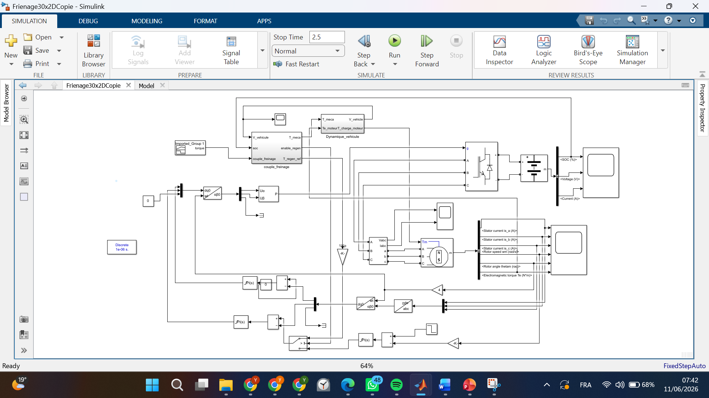
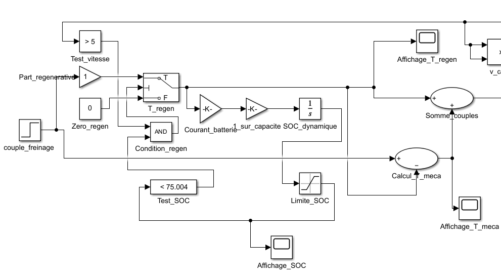
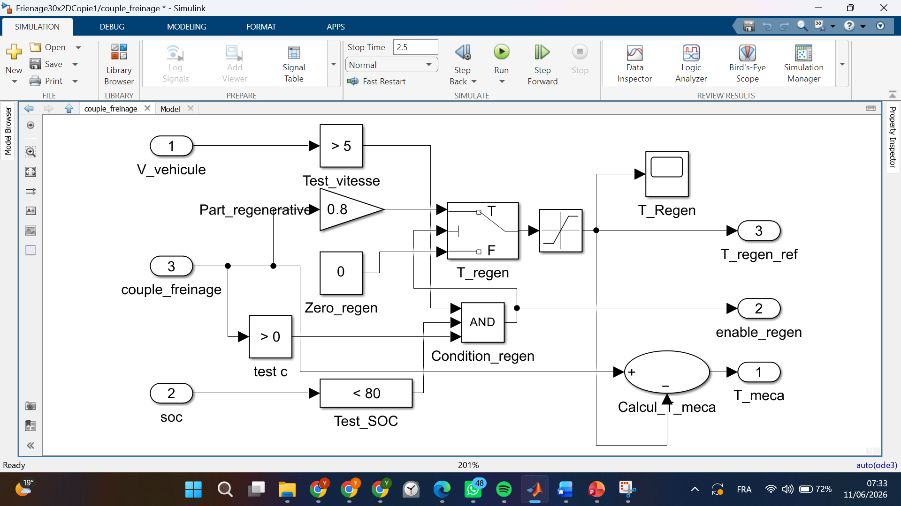
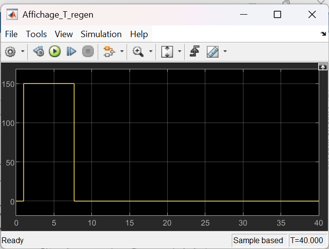
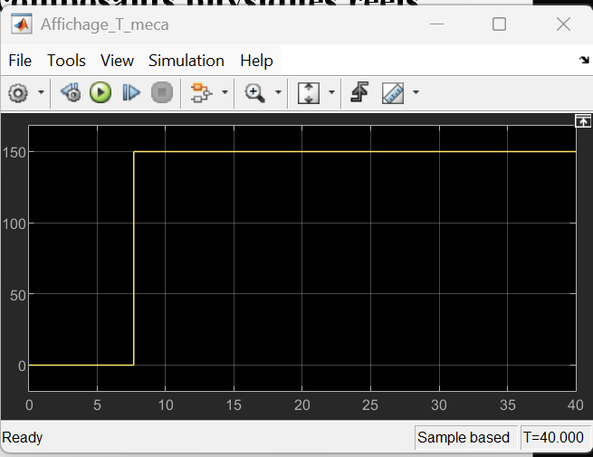
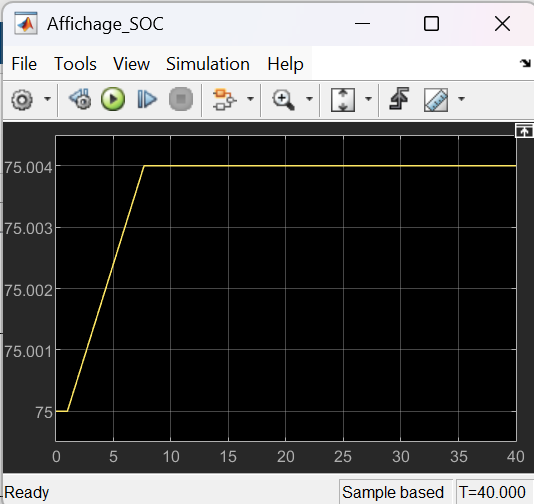
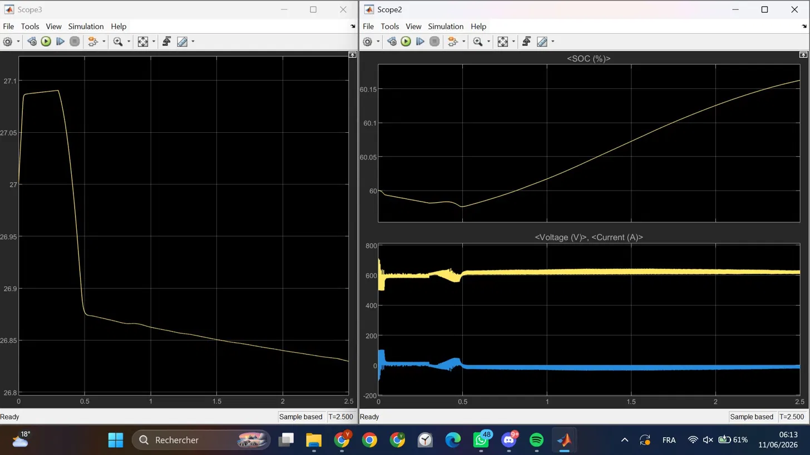

# Stratégie de freinage régénératif pour véhicules électriques et hybrides

**MATLAB / Simulink · R2024a · Étude par simulation · ENSA Berrechid**

Conception et simulation d’une stratégie qui coordonne le freinage régénératif et le freinage mécanique. Le contrôleur utilise la demande de freinage, la vitesse du véhicule et l’état de charge de la batterie (SOC) pour répartir le couple de freinage et permettre la récupération d’énergie.

> **Résultat présenté dans le support du projet :** dans la simulation à composants physiques, le SOC de la batterie passe d’environ **60 % à 60,15 %** et sa tension se stabilise autour de **600 V** après le régime transitoire initial. Lorsque la régénération est indisponible ou limitée, la stratégie de répartition confie le complément de freinage au frein mécanique.

## 1. Présentation du projet

Lors d’un freinage classique, l’énergie cinétique du véhicule est dissipée sous forme de chaleur. Le freinage régénératif utilise la machine électrique en mode génératrice pour restituer une partie de cette énergie à la batterie.

Ce projet étudie la coopération entre freinage électrique et freinage mécanique à travers une stratégie de commande supervisée.

Les principaux objectifs sont les suivants :

- Récupérer de l’énergie pendant les phases de freinage lorsque les conditions de fonctionnement le permettent.
- Répartir le couple demandé entre freinage régénératif et freinage mécanique.
- Désactiver la régénération lorsque les conditions de SOC ou de vitesse l’exigent.
- Observer la vitesse du véhicule, les couples de freinage et le SOC pendant la simulation.

Les documents du projet présentent deux niveaux de modélisation :

| Niveau de modélisation | Objectif | Éléments disponibles |
|---|---|---|
| Modèle mathématique | Étudier la dynamique longitudinale, la répartition du couple et une évolution simplifiée du SOC | Fichier fourni : `modele_freinage_regeneratif_v7.slx` |
| Modèle à composants physiques | Étudier les interactions entre la machine électrique, l’onduleur, la batterie et les boucles de commande | Architecture et captures de simulation dans `Presentation_projet.pptx` |

Les figures présentent des **résultats de simulation**. Le modèle à composants physiques représente des composants électriques dans l’environnement de simulation. Son fichier Simulink distinct ne fait pas partie des éléments fournis.

## 2. Architecture du système

La demande de freinage est transmise au contrôleur, qui vérifie la vitesse du véhicule et le SOC. Il détermine ensuite la contribution du freinage électrique et calcule le couple mécanique complémentaire.

| Sous-système | Rôle |
|---|---|
| Demande de freinage | Fournit une consigne de couple à partir d’un signal prédéfini |
| Contrôleur de supervision | Vérifie les conditions de régénération et répartit le couple |
| Dynamique du véhicule | Calcule l’évolution de la vitesse longitudinale |
| Machine électrique et onduleur | Représentent le freinage électrique et la conversion d’énergie dans le modèle à composants physiques |
| Frein mécanique | Fournit la part du couple demandé qui n’est pas assurée par la régénération |
| Batterie | Reçoit l’énergie récupérée et fournit le retour d’information sur le SOC |



*Figure 1. Architecture de simulation à composants physiques intégrant la machine électrique, l’onduleur, la batterie et les boucles de commande. Source : présentation, diapositive 12.*

## 3. Modèle mathématique

### Dynamique longitudinale du véhicule

En considérant les couples de freinage comme des grandeurs positives, le modèle v7 fourni applique la relation suivante pendant le freinage :

```text
m × dv/dt = -[(T_regen + T_meca) / Rw + F_aero + F_roll]

F_aero = 0.4224 × v²
F_roll = 176.58
```

Dans cette relation, `m` désigne la masse du véhicule, `Rw` le rayon de la roue et `v` la vitesse du véhicule. Avec des unités SI cohérentes, le couple est exprimé en N·m, la force en N et la vitesse en m/s.

Le modèle convertit le couple total de freinage en force longitudinale, ajoute les résistances aérodynamique et au roulement, puis intègre l’accélération pour obtenir la vitesse.

### Répartition du couple

```text
T_request = T_regen + T_meca
T_meca    = T_request - T_regen
```

Le freinage régénératif fournit la contribution électrique autorisée. Le freinage mécanique assure le complément de la demande.

### Représentation du SOC de la batterie

Le modèle v7 fourni utilise une chaîne de recharge simplifiée reposant sur des gains :

```text
I_battery = -0.01 × (0.95 × T_regen)
dSOC/dt   = -I_battery / 5000
```

L’intégrateur du SOC démarre à 50 % et sa sortie affichée est limitée à l’intervalle 0–100 %. Le facteur `0.95` représente une approximation du rendement de l’onduleur dans cette chaîne. Les gains fixes décrivent une évolution simplifiée du SOC plutôt qu’un modèle de capacité de batterie étalonné.



*Figure 2. Capture du modèle de principe issue de la diapositive 6. Elle correspond à un scénario antérieur dont le seuil de SOC diffère de celui du fichier v7 fourni.*

## 4. Stratégie de commande

### Logique du modèle v7 fourni

Pour une demande de couple de freinage positive, la régénération est autorisée lorsque les deux conditions suivantes sont vérifiées :

```text
vehicle_speed > speed_threshold
SOC < SOC_max
```

Le contrôleur combine ces conditions avec un bloc ET et sélectionne soit la contribution régénérative, soit une valeur nulle.

**Pseudo-code :**

```text
si la régénération est autorisée :
    T_regen = alpha × T_request
sinon :
    T_regen = 0

T_meca = T_request - T_regen
```

`alpha` correspond au gain configuré dans le bloc `Part_regenerative`. La demande de freinage est générée par le bloc `Signal Builder` du modèle.

### Contrôleur étendu présenté dans les diapositives

Le contrôleur du modèle à composants physiques comprend également une vérification de la demande positive de freinage et un bloc de saturation du couple régénératif. Le gain `Part_regenerative` illustré vaut `0.8`.



*Figure 3. Contrôleur présenté à la diapositive 10 : vérification de la vitesse, de la demande positive de couple et du SOC, puis saturation du couple régénératif et calcul du complément mécanique.*

Le couple moteur, le courant de recharge de la batterie et la puissance récupérée sont des contraintes abordées dans la présentation. Le fichier mathématique v7 fourni met explicitement en œuvre les vérifications de vitesse et de SOC. Il ne contient pas l’ensemble des composants électriques ni toutes les limites de recharge illustrées ou discutées dans la présentation.

## 5. Paramètres enregistrés dans le modèle v7

| Paramètre | Valeur enregistrée | Bloc ou réglage du modèle |
|---|---|---|
| Masse du véhicule | 1 200 kg | `Acceleration` : gain `-1/1200` |
| Rayon de la roue | 0,3 m | `1_Rw` : gain `1/0.3` |
| Vitesse initiale | `50` | `vitesse_vehicule` : condition initiale |
| Vitesse minimale de régénération | `5` | `Test_vitesse` : comparaison stricte `>` |
| SOC initial | 50 % | `SOC_dynamique` |
| Seuil de SOC pour la régénération | 80 % | `Test_SOC` : comparaison stricte `<` |
| Limites du SOC affiché | 0–100 % | `Limite_SOC` |
| Approximation du rendement de l’onduleur | 0,95 | `Onduleur_rendement` |
| Résistance au roulement | 176,58 N | `Force_roulement` |
| Coefficient de la force aérodynamique | 0,4224 multiplié par `v²` | `coeff_aerodynamique` |
| Intervalle de simulation | 0–40 s | Configuration du modèle |
| Configuration du solveur | Sélection automatique à pas variable | `VariableStepAuto` |

Le signal de vitesse est utilisé directement, sans bloc de conversion des km/h en m/s. Sa valeur initiale et son seuil doivent être cohérents avec les unités retenues dans les équations de dynamique.

La présentation contient plusieurs scénarios de développement avec des valeurs initiales et des seuils de SOC différents. Chaque capture doit donc être interprétée avec les réglages de son scénario, plutôt que comme le résultat d’une même simulation avec les paramètres par défaut du modèle v7.

## 6. Résultats de simulation

Les résultats suivants proviennent de la présentation fournie.

### 6.1 Coordination des couples régénératif et mécanique

Les courbes du modèle de principe illustrent le passage du freinage électrique au freinage mécanique lorsque la condition de régénération cesse d’être vérifiée.

| Couple de freinage régénératif | Couple de freinage mécanique |
|---|---|
|  |  |

*Figures 4–5. Évolution complémentaire des couples de freinage présentée à la diapositive 15.*

Le modèle calcule la contribution mécanique à partir de la différence entre le couple demandé et le couple régénératif.

### 6.2 Évolution du SOC dans le scénario du modèle de principe



*Figure 6. Le scénario illustré démarre autour de 75 % de SOC et atteint environ 75,004 %, puis un plateau. Source : présentation, diapositive 15.*

L’augmentation du SOC traduit la tendance à la recharge représentée par le modèle simplifié. Cette capture utilise des conditions initiales et un seuil différents de ceux enregistrés par défaut dans le modèle v7 fourni.

### 6.3 Simulation à composants physiques



*Figure 7. Évolution de la vitesse du véhicule, du SOC, de la tension et du courant de la batterie dans la simulation à composants physiques. Source : présentation, diapositive 16.*

| Observation rapportée dans la présentation | Interprétation |
|---|---|
| Le SOC passe d’environ 60 % à 60,15 % | La batterie simulée reçoit de l’énergie pendant le scénario de freinage présenté |
| Le courant de recharge devient négatif selon la convention de signe affichée | La batterie entre dans une phase de recharge |
| La tension se stabilise autour de 600 V après le régime transitoire initial | La réponse électrique tracée se rapproche d’un régime établi |
| Le frein mécanique fournit le complément lorsque la régénération est limitée | Le contrôleur assure la répartition du couple demandé |

L’augmentation de SOC rapportée est d’environ **0,15 point de pourcentage**. Il s’agit d’une variation propre au scénario présenté, et non d’un rendement de récupération d’énergie mesuré ou d’un gain d’autonomie chiffré.

### 6.4 Conditions de fonctionnement étudiées dans la présentation

| Condition | Réponse attendue de la commande | Éléments présents dans les documents du projet |
|---|---|---|
| Vitesse du véhicule inférieure au seuil de régénération | Annuler le couple régénératif et utiliser le freinage mécanique | Comparaison de vitesse et commutateur du modèle v7 ; synthèse des scénarios à la diapositive 19 |
| SOC supérieur ou égal au seuil | Désactiver la régénération et transférer la demande au freinage mécanique | Comparaison du SOC et logique ET dans le modèle v7 |
| Demande de freinage supérieure au couple régénératif autorisé | Limiter la contribution électrique et fournir le complément mécaniquement | Bloc de saturation du contrôleur étendu ; synthèse des scénarios à la diapositive 19 |

## 7. Ouvrir et simuler le modèle fourni

### Prérequis

- MATLAB et Simulink.
- Le modèle a été enregistré avec **MATLAB R2024a**.
- Le modèle mathématique utilise des blocs Simulink standards et une entrée enregistrée dans Signal Builder.

### Étapes de simulation

1. Ouvrir MATLAB dans le dossier contenant `modele_freinage_regeneratif_v7.slx`.
2. Ouvrir le modèle et examiner le profil de couple de freinage dans `Signal Builder`.
3. Lancer la simulation de 40 secondes enregistrée dans le modèle.
4. Ouvrir les oscilloscopes pour observer le SOC, la vitesse du véhicule et les couples de freinage.

```matlab
mdl = 'modele_freinage_regeneratif_v7';
open_system([mdl '.slx']);

simOut = sim(mdl, 'StopTime', '40');

open_system([mdl '/Affichage_SOC']);
open_system([mdl '/Affichage_T_regen']);
open_system([mdl '/Affichage_T_mecanique']);
open_system([mdl '/Affichage_vitesse']);
```

Pour étudier le comportement de la commande, faire varier le SOC initial, le seuil de vitesse ou la demande de freinage, puis comparer les contributions régénérative et mécanique.

Les captures à composants physiques correspondent à un modèle distinct. L’exécution du fichier v7 fourni permet de simuler son architecture mathématique, et non ce modèle électrique distinct.

## 8. Fichiers du dépôt

| Chemin | Contenu |
|---|---|
| [modele_freinage_regeneratif_v7.slx](modele_freinage_regeneratif_v7.slx) | Modèle mathématique Simulink |
| [Presentation_projet.pptx](Presentation_projet.pptx) | Présentation du projet et figures originales de simulation |
| `README.md` | Description du projet et instructions de simulation |
| `docs/images/` | Sept images extraites de la présentation du projet |

Conserver `docs/images/` à côté de ce README en respectant la même arborescence pour que les figures s’affichent sur GitHub.

## 9. Périmètre du modèle et perspectives

Le modèle fourni illustre la répartition du couple et une évolution simplifiée du SOC. Les développements suivants permettraient d’améliorer sa fidélité physique et la couverture des essais :

- Remplacer la chaîne de SOC à gains fixes par un modèle de batterie avec une capacité, une tension et des limites de courant de recharge documentées.
- Ajouter des limites explicites de couple moteur, de courant de recharge et de puissance récupérée au modèle mathématique.
- Limiter la vitesse du véhicule à zéro pour les études d’arrêt. L’intégrateur de vitesse du modèle v7 enregistré n’est pas borné.
- Comparer l’énergie récupérée et le comportement au freinage sur des cycles de conduite définis et des scénarios répétés.
- Étendre l’étude aux contraintes de glissement des roues et de stabilité au freinage.

Les éléments fournis documentent un travail de simulation. Ils ne permettent pas d’établir des performances mesurées sur véhicule, une validation matérielle ou un gain d’autonomie chiffré.

## 10. Équipe du projet et cadre académique

| Rôle | Nom |
|---|---|
| Équipe du projet | **OUBEN SAID Ibrahim** |
| Équipe du projet | **AROUK Younes** |
| Équipe du projet | **EL-GHABED Khalil** |
| Encadrant | **Pr. Fannakh** |

**Établissement :** Université Hassan Première, École Nationale des Sciences Appliquées de Berrechid  
**Filière ingénieur :** Automobile et Solutions Digitales  
**Année universitaire :** 2025–2026

Toutes les figures de ce README ont été extraites de la présentation fournie. Le contenu original des sept images est conservé.

---

**Bilan du projet :** les simulations présentées illustrent la coordination des freinages régénératif et mécanique, avec un retour du SOC utilisé pour autoriser ou inhiber la régénération. Les résultats à composants physiques présentés par l’équipe montrent une phase de recharge et une augmentation du SOC pendant le scénario de freinage illustré.
